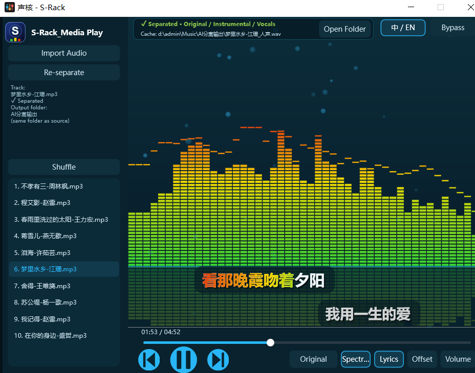

# S-Rack

**English** · [简体中文](README.zh-CN.md)

> **v1.0.0** · Windows x64 · VST3 effect plugin + standalone player · JUCE 8 / C++17



[简体中文界面截图](docs/screenshot-zh-CN.png)

S-Rack is a cyberpunk-styled music player that ships in two forms:

- **VST3 plugin** — load it on any track in a DAW / rack host (classified as `Fx`).
- **Standalone app** — double-click `S-Rack.exe`, no host required.

Both contain the same player, the same MDX-Net separation engine, and bundle their own runtime dependencies.

---

## Features

| | |
|---|---|
| 🎵 **Decoding** | Streaming decode inside `processBlock` via Windows Media Foundation. MP3 / M4A / AAC / FLAC / OGG / WAV / WMA / AIFF, including MP4/AAC files disguised with an `.mp3` extension. |
| 📊 **Spectrum** | Segmented LED bars, green → yellow → red vertical gradient, peak caps and a mirrored reflection under the baseline. |
| 🎤 **KTV lyrics** | Loads a same-named `.lrc` next to the audio. Supports enhanced word-level timing (`<mm:ss.xx>`) and ordinary line timing. Two staggered lines (current line left, next line right) with clear vertical spacing; the sung portion uses the same VU colours as the spectrum (red → yellow → green gradient), the unsung part stays white. |
| ⏱ **Lyric offset** | Click **Offset** to open a slider; pull up / down for ±10 s, remembered per track. |
| 🎛 **Playback** | Multi-file playlist, four modes (Sequential / Loop All / Loop One / Shuffle), draggable seek bar, spectrum & lyrics toggles. |
| 🎚 **Separate Audio** | One click runs MDX-Net on the current track and writes **Vocals** and **Instrumental** WAVs to disk. Afterwards switch **Original / Instrumental / Vocals** with a 40 ms smooth crossfade (no clicks). |
| 🔀 **Bypass** | Pass the host track input straight through, without mixing in the plugin's internal player. |
| 🌐 **Bilingual UI** | Simplified Chinese by default; switch to English with the top-right **中 / EN** button. Language, playlist, position, volume, bypass and toggles are all saved with the host project. |

> **About separation:** S-Rack uses *offline pre-separation*, not real-time stem extraction. MDX-Net runs at roughly 0.62× real time, so a 5-minute song takes about 8 minutes. You can keep listening to the original while it runs; when it finishes, the output-source switch unlocks automatically. Once the WAVs exist on disk, they are reused instantly on the next load.

---

## Downloads

Release assets are published separately so you only install what you need:

| Asset | Contents |
|---|---|
| `S-Rack-Standalone-v1.0.0-win64.zip` | `S-Rack.exe` + `onnxruntime.dll` + `Kim_Vocal_2.onnx` + `vocals_weights.bin` |
| `S-Rack-VST3-v1.0.0-win64.zip` | `S-Rack.vst3` bundle (already contains the DLL, model and weights) |

See [Releases](../../releases).

### Install

- **Standalone**: unzip anywhere and run `S-Rack.exe`. In the audio settings, pick the correct output device.
- **VST3**: copy the whole `S-Rack.vst3` folder to `C:\Program Files\Common Files\VST3\`, then rescan plugins in your host. The build script does this automatically.
- ⚠️ If a legacy `MediaPlay.vst3` is still present, **delete it**. It shares the same VST3 class ID as `S-Rack.vst3` and may appear as a duplicate or cause hosts to load the wrong bundle.

---

## Getting started

1. **Import Audio** — pick one or more files; they are added to the playlist but do not auto-play.
2. Press **Play**. Drag the seek bar to jump.
3. **Lyrics** — place `<song name>.lrc` in the same folder as the audio; it loads automatically.
4. **Separate Audio** — click once, watch the progress on the button, then use the output-source button to switch between Original / Instrumental / Vocals.
5. **Bypass** and **中 / EN** both live in the top-right corner.

### Where are the separated files?

They are written next to the source file, in a folder called `AI分离输出`:

```
<folder of the song>\
└── AI分离输出\
    ├── <song>_人声.wav        (vocals)
    ├── <song>_伴奏.wav        (instrumental)
    └── 导出结果.txt           (export manifest, written incrementally)
```

The top status strip shows the **full cache path**, a tooltip repeats it, and **Open Folder** opens the directory. These folder and file names are deliberately *not* translated when the UI is switched to English, so the cache stays valid in both languages.

---

## Build from source

Requirements: Windows 10/11 x64, Visual Studio 2022 (MSVC v143), Windows SDK 10, CMake ≥ 3.22, Ninja.

`ThirdParty/` is git-ignored, so a fresh clone needs these dependencies placed manually:

| Path | What |
|---|---|
| `ThirdParty/juce-8.0.15/` | [JUCE 8.0.15](https://github.com/juce-framework/JUCE/releases/tag/8.0.15) (must contain `modules/` and `CMakeLists.txt` directly) |
| `ThirdParty/onnxruntime-win-x64-1.17.1/` | ONNX Runtime 1.17.1 Windows x64 (`include/`, `lib/onnxruntime.lib`, `lib/onnxruntime.dll`) |
| `ThirdParty/kissfft/` | kissfft sources |
| `ThirdParty/Kim_Vocal_2.onnx` | MDX-Net vocal model (~64 MB) |
| `Tools/vocals_weights.bin` | Auxiliary weights |

Then run:

```bat
build.bat
```

It configures with Ninja and builds `VstMediaPlayer_VST3`, `VstMediaPlayer_Standalone`, `AudioDump` and `SepVerify`. Outputs land in `build/VstMediaPlayer_artefacts/Release/`:

```
Standalone/S-Rack.exe
VST3/S-Rack.vst3/...
AudioDump_artefacts/Release/AudioDump.exe
SepVerify_artefacts/Release/SepVerify.exe
```

The POST_BUILD step copies `onnxruntime.dll`, `Kim_Vocal_2.onnx` and `vocals_weights.bin` next to the exe, into the VST3 bundle, and into the system VST3 folder.

> **Why the bundled ONNX Runtime matters:** some systems have ONNX Runtime 1.5.2 in `C:\Windows\System32`. A statically imported `onnxruntime.dll` would resolve to that old DLL first, `GetApi(17)` would return `nullptr`, and constructing `Ort::Env` would crash the host process. S-Rack rebinds the ORT API table to the bundled 1.17.1 DLL using an absolute path before any model is created. If rebinding fails, separation is disabled but playback and the host stay alive.

### Diagnostics

Debug output goes to `D:\Xiangmu\S-Rack\mp_debug.log` by default; override with the `MEDIAPLAY_LOG` environment variable. Check it for `[ORT] rebound OK`, `[VOCAL] cache hit` and `[audio] render` lines when troubleshooting.

---

## Project layout

```
Source/                 plugin processor, single-page editor, visualizer,
                        lyrics, MF decoder, separation / export / cache
Assets/                 S-Rack icons + generate_icon.py
ThirdParty/             JUCE, ORT, kissfft, MDX model (git-ignored)
Tools/                  AudioDump / SepVerify / model analysis scripts + weights
Tests/                  engine test + sample media
docs/                   UI screenshots (zh-CN / en + earlier layout)
CMakeLists.txt          build definition (project version 1.0.0)
build.bat               MSVC environment + configure + build
```

The internal CMake target is still named `VstMediaPlayer` and the VST3 `PLUGIN_CODE` / `BUNDLE_ID` are unchanged on purpose: VST3 identifies plugins by class ID, so hosts can find the same plugin again after a rescan even though the product is now called S-Rack.

---

## License

For study and personal experimentation only.
