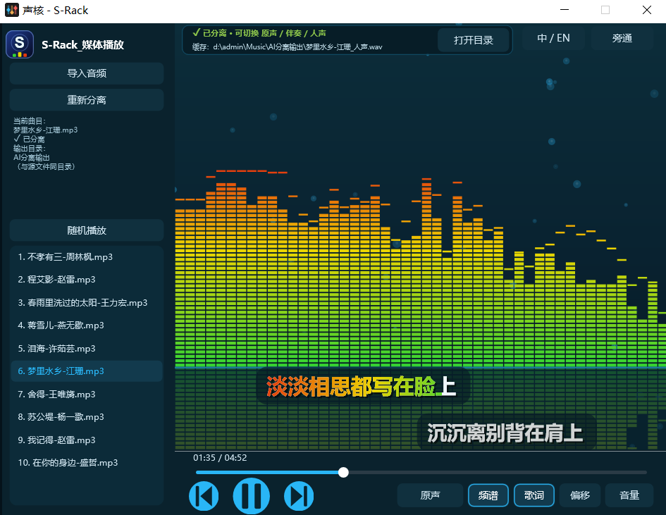

# S-Rack

[English](README.md) · **简体中文**

> **v1.0.0** · Windows x64 · VST3 效果器插件 + 独立播放器 · JUCE 8 / C++17



[English UI 截图](docs/screenshot-en.png)

S-Rack 是一款赛博朋克风格的音频播放器，提供两种形态：

- **VST3 插件** —— 可加载到 DAW / 机架的任意轨道（分类为 `Fx`）。
- **独立播放器** —— 双击 `S-Rack.exe` 即可使用，无需宿主。

两者共用同一套播放引擎与 MDX-Net 分离引擎，并自带运行期依赖。

---

## 功能特性

| | |
|---|---|
| 🎵 **直读解码** | 在 `processBlock` 内通过 Windows Media Foundation 流式解码，支持 MP3 / M4A / AAC / FLAC / OGG / WAV / WMA / AIFF，能识别伪装成 `.mp3` 的 MP4/AAC 容器。 |
| 📊 **LED 频谱** | 分段频谱柱，自底向上 绿 → 黄 → 红 渐变，带峰值帽与基线倒影。 |
| 🎤 **KTV 歌词** | 自动读取音频同目录同名 `.lrc`，支持增强逐字时间轴（`<mm:ss.xx>`）与普通逐句格式。双行错位排布（当前行靠左、下一行靠右），上下留净空不重叠；已唱部分用频谱同款 **红 → 黄 → 绿** 渐变，未唱为白色。 |
| ⏱ **歌词偏移** | 点「偏移」弹出调节条，上拉提前 / 下拉延后（±10s），按曲目记忆并持久化。 |
| 🎛 **播放管理** | 多文件播放列表、四种播放模式（顺序 / 列表循环 / 单曲循环 / 随机）、进度条拖动 seek、频谱与歌词开关。 |
| 🎚 **分离音频** | 一键用 MDX-Net 分离当前曲目，把「人声 / 伴奏」写成 WAV 落盘；随后可切换 **原声 / 伴奏 / 人声**，40ms 线性平滑过渡，切换无爆音。 |
| 🔀 **旁通** | 只让宿主轨道输入原样通过，不叠加插件内置播放器的声音（不是静音）。 |
| 🌐 **中英切换** | 默认简体中文，点右上角「中 / EN」切 English。语言、播放列表、播放位置、音量、旁通及各开关都随宿主工程保存恢复。 |

> **关于分离**：S-Rack 采用**离线预分离**，不做实时分轨。MDX-Net 速度约为 0.62× 实时，一首 5 分钟的歌约需 8 分钟。分离期间可继续正常听原声，完成后输出源切换按钮自动解锁。WAV 一旦落盘，下次加载同曲会直接命中缓存，秒开切换。

---

## 下载与安装

发布时 exe 与 VST3 **分开打包**，按需取用：

| 资产 | 内容 |
|---|---|
| `S-Rack-Standalone-v1.0.0-win64.zip` | `S-Rack.exe` + `onnxruntime.dll` + `Kim_Vocal_2.onnx` + `vocals_weights.bin` |
| `S-Rack-VST3-v1.0.0-win64.zip` | `S-Rack.vst3` 包（已内含 DLL、模型与权重） |

见 [Releases](../../releases)。

- **独立版**：解压到任意目录运行 `S-Rack.exe`，在音频设置里选对输出设备。
- **VST3**：把整个 `S-Rack.vst3` 文件夹复制到 `C:\Program Files\Common Files\VST3\`，再到宿主里重新扫描插件（构建脚本会自动完成这一步）。
- ⚠️ 若系统里还留着旧版 `MediaPlay.vst3`，请**手动删除**：它与 `S-Rack.vst3` 使用同一 VST3 class ID，宿主可能列出两个插件或加载到错误的包。

---

## 快速上手

1. **导入音频** —— 可多选，导入后只加入列表，不自动播放。
2. 按 **播放**；拖动进度条可跳转。
3. **歌词** —— 把与音频同名的 `.lrc` 放在同一目录，自动加载。
4. **分离音频** —— 点一次，按钮上显示进度；完成后用输出源按钮切换 原声 / 伴奏 / 人声。
5. **旁通** 与 **中 / EN** 都在窗口最右上角并排。

### 分离后的文件在哪？

写在源文件同目录的 `AI分离输出` 文件夹里：

```
<歌曲所在目录>\
└── AI分离输出\
    ├── <曲名>_人声.wav        （人声）
    ├── <曲名>_伴奏.wav        （伴奏）
    └── 导出结果.txt           （导出清单，逐个文件即时落盘）
```

主区顶部状态条会显示**完整缓存路径**，鼠标悬停也有 tooltip，点「打开目录」可直接打开。这些目录名与文件名**刻意不随界面语言翻译**，因此中英文模式下缓存始终一致。

---

## 从源码构建

环境：Windows 10/11 x64、Visual Studio 2022（MSVC v143）、Windows SDK 10、CMake ≥ 3.22、Ninja。

`ThirdParty/` 已被 `.gitignore` 排除，全新克隆后需手动放置以下依赖：

| 路径 | 内容 |
|---|---|
| `ThirdParty/juce-8.0.15/` | [JUCE 8.0.15](https://github.com/juce-framework/JUCE/releases/tag/8.0.15)（目录内直接包含 `modules/` 与 `CMakeLists.txt`） |
| `ThirdParty/onnxruntime-win-x64-1.17.1/` | ONNX Runtime 1.17.1 Windows x64（`include/`、`lib/onnxruntime.lib`、`lib/onnxruntime.dll`） |
| `ThirdParty/kissfft/` | kissfft 源码 |
| `ThirdParty/Kim_Vocal_2.onnx` | MDX-Net 人声模型（约 64 MB） |
| `Tools/vocals_weights.bin` | 辅助权重 |

然后运行：

```bat
build.bat
```

脚本用 Ninja 配置并构建 `VstMediaPlayer_VST3`、`VstMediaPlayer_Standalone`、`AudioDump`、`SepVerify`。产物位于 `build/VstMediaPlayer_artefacts/Release/`：

```
Standalone/S-Rack.exe
VST3/S-Rack.vst3/...
AudioDump_artefacts/Release/AudioDump.exe
SepVerify_artefacts/Release/SepVerify.exe
```

POST_BUILD 步骤会把 `onnxruntime.dll`、`Kim_Vocal_2.onnx`、`vocals_weights.bin` 复制到 exe 同目录、VST3 包内以及系统 VST3 目录。

> **为什么必须随包分发 ONNX Runtime**：部分系统的 `C:\Windows\System32\onnxruntime.dll` 是 1.5.2。静态导入若先解析到它，`GetApi(17)` 会返回空指针，首次构造 `Ort::Env` 就会让整个宿主崩溃。S-Rack 在创建任何模型前，用绝对路径把 ORT API 表重定向到随包分发的 1.17.1；即使重定向失败，也只是分离功能不可用，播放与宿主不受影响。

### 诊断日志

默认写到 `D:\Xiangmu\S-Rack\mp_debug.log`，可用环境变量 `MEDIAPLAY_LOG` 覆盖。排障时关注 `[ORT] rebound OK`、`[VOCAL] cache hit`、`[audio] render` 等条目。

---

## 目录结构

```
Source/                 插件处理器、单页编辑器、频谱、歌词、MF 解码、分离/导出/缓存
Assets/                 S-Rack 图标 + generate_icon.py
ThirdParty/             JUCE、ORT、kissfft、MDX 模型（不入库）
Tools/                  AudioDump / SepVerify / 模型分析脚本与权重
Tests/                  引擎测试与样例音频
docs/                   界面截图（中文 / 英文 + 早期版本）
CMakeLists.txt          构建定义（工程版本 1.0.0）
build.bat               MSVC 环境 + 配置 + 构建
```

内部 CMake target 仍叫 `VstMediaPlayer`，VST3 的 `PLUGIN_CODE` / `BUNDLE_ID` 也刻意保留旧值：VST3 靠 class ID 识别插件，这样产品改名为 S-Rack 后，宿主重新扫描仍能找回同一个插件。

---

## 许可

仅供学习交流使用。
